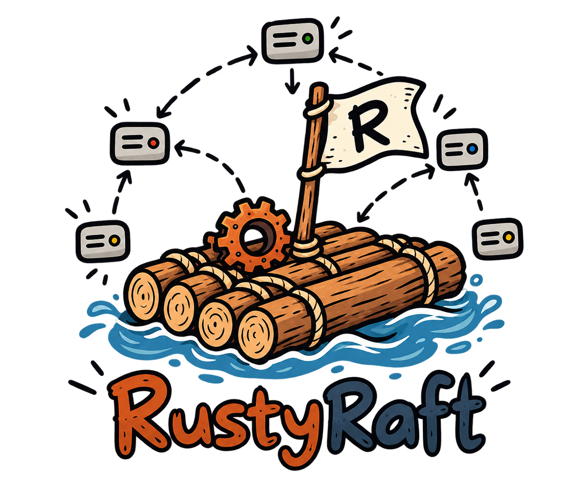

  

- [RustyRaft](#rustyraft)
- [References](#references)

### RustyRaft

Rust implementation of the Raft consensus algorithm.

The goal is to build it piece by piece, understand the decisions behind it, and make sure those decisions hold up when things go wrong.

I want to keep the design simple, the protocol easy to reason about, and the tests useful enough to catch mistakes before they become harder to find. That means testing more than the happy path: messages can be lost or delayed, nodes can crash, networks can split, and processes can restart with state left behind.

As the project grows, I want to tackle the harder parts too: durable storage, recovery, changing cluster membership without downtime, and making the system observable and operable.

The long-term goal is a Raft implementation that is not only correct in theory, but reliable under failure, understandable in its design, and practical to run.

### References

The main reference for the implementation is the Raft paper.

- [Raft: In Search of an Understandable Consensus Algorithm](https://raft.github.io/raft.pdf)
- [My Raft notes](https://github.com/souraavv/whitepapers-and-books/blob/main/whitepapers/raft.md)
